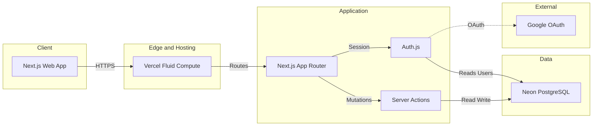

# Arquitetura Proposta

## 1. Objetivos arquiteturais

- Entregar uma aplicação web responsiva;
- Usar tecnologias compatíveis com React, Next.js e Node.js;
- Separar os domínios centrais do produto;
- Isolar dados por usuário desde o começo;
- Permitir a evolução para multiusuário;
- Evitar dependência prematura de IA ou de integrações complexas;
- Facilitar testes e desenvolvimento orientado a especificações.

## 2. System design (as-built)

Diagrama visual (FigJam): [Segundo Cérebro — System Design](https://www.figma.com/board/Ie3nZIqaGVlBHAedB17nq7).  
Tokens e UI base: [docs/design-system.md](./design-system.md) (Figma Foundations).

### Stack confirmada

| Camada | Escolha |
| --- | --- |
| Client | Next.js App Router + React + TypeScript |
| Hosting | Vercel (Fluid Compute, Node.js) |
| Application | Server Components, Server Actions, `cacheComponents` |
| Auth | Auth.js v5 — Google OAuth + Credentials (JWT) |
| Persistence | Drizzle ORM + Neon PostgreSQL (`neon-http`) |
| Validation | Zod |
| UI icons | `lucide-react` (áreas) |
| Tests | Vitest (DB de teste) + Playwright (e2e) |

Ainda não no as-built: e-mail transacional, Vercel Cron de lembretes, fila async, RAG/IA.

### Diagrama lógico

### Módulos de aplicação

Código em `src/features/<domínio>/{domain,application,infra,presentation}` + `src/shared`.  
Cada feature expõe API client-safe e `server.ts` com `server-only`.

| Feature | Responsabilidade atual |
| --- | --- |
| `auth` | Login Google/senha, sessão, rate limit de login |
| `preferences` | Fuso, template de journal |
| `pillars` | CRUD, ordem, arquivar |
| `horizons` | Rótulos de prazo + seed atômico |

Rotas autenticadas sob `/app/*` chamam `requireUserId()`; mutações só via Server Actions (sem REST público no MVP).

## 3. Proposta inicial de stack (histórico)

Antes do as-built, a proposta era:

- **Frontend e aplicação web:** Next.js com React e TypeScript;
- **Backend:** endpoints de servidor do Next.js ou serviço Node.js separado, conforme a necessidade;
- **Banco de dados:** PostgreSQL;
- **Acesso a dados:** camada de persistência tipada, escolhida conforme a stack final;
- **Autenticação:** solução compatível com Next.js e com o banco selecionado;
- **E-mail:** provedor externo de envio transacional;
- **Tarefas agendadas:** serviço de cron ou fila para lembretes;
- **Hospedagem:** provedor que suporte a aplicação, banco, tarefas agendadas e gestão segura de segredos.

Seção 2 acima reflete o que já está implementado.

## 4. Contextos de domínio

### Identidade e preferências

Responsável por autenticação, perfil, fuso horário e preferências globais.

### Organização pessoal

Responsável por áreas, tags e configuração do dashboard.

### Metas

Responsável por metas, prazos, estado e próximos passos.

### Hábitos e registros

Responsável por definição de hábitos, frequências e logs diários.

### Journaling

Responsável pelos check-ins, textos livres e revisões.

### Lembretes

Responsável por preferências, agendamento e envio de notificações.

### Exportação

Responsável por gerar e disponibilizar arquivos com os dados do usuário.

### Inteligência artificial futura

Contexto reservado para busca semântica, RAG e geração de insights. Não faz parte do MVP.

## 5. Preparação para múltiplos usuários

Mesmo que inicialmente exista apenas uma usuária, os dados devem ser vinculados a `user_id`.

Requisitos:

- Toda consulta deve restringir resultados ao usuário autenticado;
- Toda operação de leitura ou escrita deve validar a autorização no servidor;
- Não confiar em um `user_id` enviado pelo cliente sem validação;
- Se a plataforma de banco permitir, aplicar políticas de segurança no próprio banco;
- Criar testes que verifiquem isolamento entre usuários.

## 6. Arquitetura lógica

Fluxo geral:

1. O cliente apresenta as telas e formulários.
2. A camada de aplicação autentica o usuário e valida os dados.
3. Os serviços de domínio aplicam as regras de negócio.
4. A camada de persistência lê e grava os dados no banco.
5. Um processo agendado identifica lembretes pendentes.
6. O serviço de notificação envia e registra o resultado.

## 7. Notificações agendadas

Fluxo proposto:

1. O usuário configura um horário e um fuso.
2. O sistema armazena essa preferência.
3. Uma tarefa agendada consulta as preferências ativas.
4. O sistema determina quais lembretes devem ser enviados naquele momento.
5. O envio é registrado para evitar duplicidade.
6. Falhas de envio são registradas e tratadas conforme uma política de retentativa.

A definição do momento exato do lembrete e da política de repetição deve ser documentada antes da implementação.

## 8. Dados e datas

- Armazenar instantes de criação e alteração em UTC;
- Armazenar datas de check-in como datas locais associadas ao fuso do usuário;
- Tratar mudanças de fuso horário de forma explícita;
- Não converter silenciosamente uma data de check-in para outro dia;
- Guardar a data de referência do registro separada do instante em que foi criado, quando necessário.

## 9. Observabilidade

O sistema deve registrar erros técnicos importantes sem incluir textos pessoais, dados de saúde ou conteúdo de journaling nos logs por padrão.

Eventos úteis:

- Falha no envio de e-mail;
- Falha de autenticação;
- Erros de validação;
- Erros de persistência;
- Falha na geração de exportação.

## 10. Evolução para IA e RAG

Na fase futura:

- Só indexar dados com autorização e finalidade explícitas;
- Isolar índices e consultas por usuário;
- Permitir ao usuário desativar a indexação e excluir dados derivados;
- Não usar insights de IA como diagnóstico ou orientação profissional;
- Mostrar quais registros deram origem a um insight;
- Tratar relações entre áreas como hipóteses ou correlações, nunca como causalidade garantida.